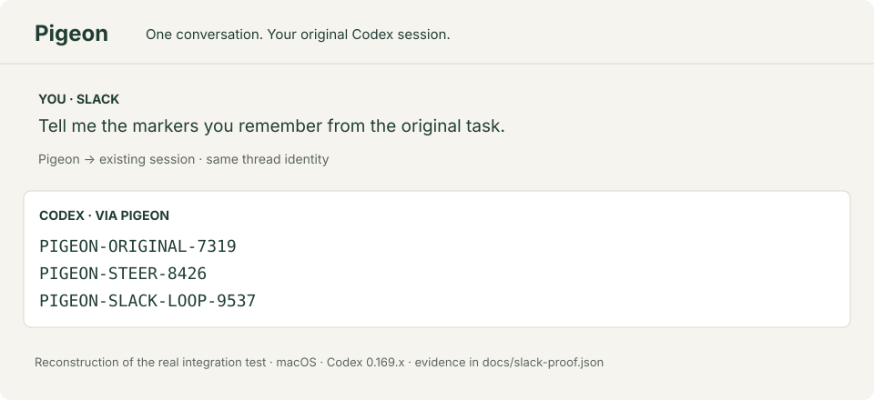

# Pigeon

**Your coding agent is one message away.**

Your agent is working on your computer. You’re somewhere else.

It needs approval, has a question, or you simply want to know what it’s doing.
Pigeon connects your running Codex sessions to Slack, so you can stay involved
without returning to your terminal.

**Working preview for macOS.** Real Slack round trips, live steering, native command
approvals, and structured human input have been tested against Codex CLI 0.169.0
and its shared daemon 0.169.1. See the [evidence](docs/TESTING.md), including the
restrictions below. This package has not been published to npm.

**Visual docs:** an interactive demo, annotated Slack setup guide, routing rules, troubleshooting
and architecture notes live in [`website/`](website/index.html). It is a static site; preview it
with `python3 -m http.server -d website` and rebuild the docs pages with `node website/build.mjs`.



```text
You → Slack DM → Pigeon on your Mac → existing Codex daemon
                                         ↕
                                your original Codex session
```

Open Codex normally. Pigeon joins the shared local runtime; it doesn’t launch a
replacement model or scrape a terminal. Status questions use observed activity.
Instructions steer the active turn, or start the next turn in the same idle session.

## Try it

Requires macOS, Node.js 24+, npm, Slack workspace permission to install a custom
app, and an authenticated Codex installation with a reachable shared daemon.

From this checkout:

```bash
npm ci
npm run build
node dist/cli.js setup
```

Setup opens a local page with the Slack app manifest. Create and authorize the
app, save its two tokens to Keychain, and send Pigeon the one-time pairing phrase.
The installer then creates a persistent macOS LaunchAgent. You can close the terminal.

In Slack, DM Pigeon `sessions`, choose a recognizable project, and continue in
that thread. Separate threads keep separate projects. When several sessions exist,
Pigeon asks you to choose; it does not guess. A message that prompted a selector
is **not sent automatically** after selection—send your instruction in that thread.

Slack requires an app installation and a Socket Mode token once. This preview’s
standalone installer still asks you to transfer those two tokens into its local
form. It does not offer a fictional one-click OAuth flow. See [Slack setup](docs/SLACK.md).

## Talk naturally

| Message | What Pigeon does |
| --- | --- |
| “What are you doing?” | Returns live state and the latest observed agent message/command. |
| “Focus on latency first.” | Sends your instruction to the original session; steers if a turn is active. |
| “Pause.” | Requests interruption of that session’s active turn. This does not create a resumable process checkpoint. |
| “Continue.” | Sends a new instruction in the same session. |
| “Let me know when it’s finished.” | Watches completion of the current Codex turn. |
| A reply to a structured question | Resolves that exact pending request when there is one question. |
| Approve once / Deny | Answers a native command-approval request with a one-time decision. |

Important agent messages and completed results arrive proactively after you connect the session. For an
Authenticator prompt, the agent can report the displayed number through that
conversation. Approve in the provider’s own trusted app; the agent must check
whether authentication succeeded. Pigeon does not access Authenticator.

## A colleague you can message

Pigeon’s default `colleague` voice is casual, concise and honest about what it has
actually observed. “What’s failing?” can follow a status question; “fix those first”
keeps the same project and the previous exchange. Unknown details go to the original
Codex worker, with no extra model API.

Routine progress stays quiet. Human requests, meaningful failures, requested updates
and completed turns get through. Customize with `pigeon voice`, for example
`pigeon voice set humour off` or `pigeon voice set language tr`.
See [personality and conversation](docs/PERSONALITY.md) for all options and limits.

## Compatibility and boundaries

- **Implemented and verified:** shared-daemon discovery; same-session Slack conversation;
  active-turn steering; native command approval; structured input in Plan mode;
  explicit session selection; local Keychain storage; LaunchAgent startup and bridge restart.
- **Implemented with restrictions:** deterministic status phrases; completion of a turn rather
  than arbitrary semantic milestones; one-question structured input; command approvals with
  a complete displayable command and no additional permission bundle; reconnect catch-up of
  the latest turn only. See [compatibility](docs/COMPATIBILITY.md).
- **Experimental:** the Codex daemon/control protocol itself, cross-version behavior, and
  recovery after a Codex daemon restart. Pigeon does not restart Codex during installation.
- **Unsupported:** attaching to arbitrary private stdio/embedded runtimes; generic terminal
  injection; file-change or broad permission approvals; Slack file uploads/screenshots;
  multi-question forms; Windows/Linux installation.

A saved conversation is not a live connection. Pigeon lists only sessions loaded
in the connected daemon. It checks before joining with `thread/resume`; there is
an upstream check/join race described in [the architecture](docs/ARCHITECTURE.md).
Desktop and IDE compatibility depends on whether that particular surface uses the
shared runtime. The dedicated Codex desktop app has not been tested here.

## Local, with no Pigeon service bill

Pigeon uses Slack Socket Mode, your Mac, SQLite, and your existing Codex access.
There is no cloud worker, tunnel, hosted database, separate LLM API, or recurring
Pigeon subscription. **Codex’s own access and usage are still your responsibility.**
Slack Free allows ten installed apps and exposes the latest 90 days of history;
Pigeon occupies one app slot. [Slack’s Free limits](https://slack.com/help/articles/115002422943-Usage-limits-for-free-workspaces).

## Your agent knows Pigeon

Setup installs a global skill, registers four human communication tools, and adds a short
awareness paragraph without replacing your instructions. The agent can ask a question,
request external assistance, send an update, or check whether its human is reachable.
The tools share the existing companion and return replies to the original caller.

Fresh-session discovery and a real agent-initiated Slack message are verified.
Codex’s first-use tool consent still applies; setup does not weaken execution approvals.
See [agent integration](docs/AGENT-INTEGRATION.md) for contracts, recovery, and consent.
MCP replies also work in private runtimes; independent live steering still requires the shared daemon.

## Diagnostics

```bash
pigeon status
pigeon doctor
pigeon sessions
pigeon logs
pigeon uninstall
```

Use `node dist/cli.js …` when running from source. To install the CLI locally,
`npm pack` then `npm install -g ./pigeon-dev-cli-0.1.0.tgz`. The bare npm name
`pigeon` belongs to a different project; **do not use `npx pigeon`** for this tool.
`@pigeon-dev/cli` is a proposed, unpublished name; scope ownership is not established.

Uninstall removes Pigeon’s service, Keychain items, and local state. Remove the
Slack app separately in Slack if desired. Pigeon’s owned skill, MCP registration, and instruction paragraph are removed safely;
other Codex settings and conversations are preserved.

## Build and contribute

```bash
npm run check
npm test
npm run format:check
npm run build
```

Read [architecture](docs/ARCHITECTURE.md), [research](docs/RESEARCH.md),
[tests and benchmarks](docs/TESTING.md), [security](SECURITY.md), and
[contributing](CONTRIBUTING.md). Runtime adapters, routing, persistence, approvals,
and Slack transport are separate modules. Native approvals remain subject to
Codex’s own policy; Pigeon never approves automatically.

MIT licensed. Prepared for `Murat-Barkin-Kinay/pigeon`; no remote repository or npm
package is created by setup.
