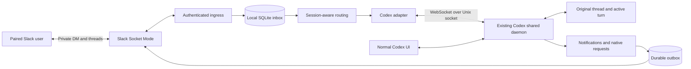

# Architecture

Pigeon is a companion to a runtime that already owns the agent. There is no
second reasoning service. Slack input crosses a transport boundary into the same
thread that the normal Codex UI is using.

## Runtime contract

`CodexRpc` initializes one bidirectional WebSocket connection over the default
local control socket under `CODEX_HOME`. The `codex app-server proxy` command is a
**byte proxy**, not a JSONL adapter: the initial failed probe established that a
WebSocket HTTP Upgrade is required on this socket. Pigeon uses `ws` directly and
never listens on a public control port.

`CodexAdapter.sessions()` pages `thread/loaded/list`, then reads metadata. Internal
subagents and threads no longer loaded are excluded. Historical `thread/list`
results are deliberately not used as proof of a controllable worker.

Joining uses `thread/resume` **on the same server** after a loaded check, with no
permission, model, directory, or instruction overrides. `excludeTurns` avoids
hydrating history while subscribing. A separate probe against a new private server
was rejected by Codex’s active-writer lock; see `writer-lock-proof.json`.

Status reads metadata and only the latest turn page. No new model turn is created.
Instructions inspect the active turn and call `turn/steer` with its required
`expectedTurnId`. A turn transition makes steering fail; it is never silently
retried as `turn/start`. Idle instructions use `turn/start` on that existing thread.
Interruptions use the precise active turn ID. Permissions remain under Codex control.

The relevant upstream protocol is [documented by OpenAI](https://learn.chatgpt.com/docs/app-server).

## The remaining atomic-attachment race

The public protocol has no atomic “subscribe only if already loaded” operation.
A thread can unload between Pigeon’s loaded check and `thread/resume`. In that
narrow race Codex may perform a cold resume. Pigeon does not bypass a lock, but it
cannot prove worker continuity in this case. A successful join of a continuously
loaded thread was demonstrated; a universal atomic guarantee is **not** claimed.

This is a reason to treat the current integration as a preview. Once subscribed,
Pigeon’s connection generally keeps the thread loaded. A daemon restart still
creates a new runtime incarnation; restoring a matching thread ID after restart
means continuity of the conversation, not persistence of an operating-system process.
See the [upstream proposal](UPSTREAM.md).

## Routing and human requests

Each Slack root message maps to one exact runtime thread. An established mapping
wins; a stale mapping fails closed. Without a mapping, a single live session can
be selected automatically. Multiple possibilities produce a project selector.
Selection does not execute the original ambiguous message.

Native requests are mapped separately from ordinary conversation. A one-time
command decision is never inferred from text such as “yes.” Random approval controls
are bound to the connection generation, native request ID, and Slack conversation.
A native resolution invalidates Pigeon’s copy. Only a single, non-secret structured
question can be answered in Slack; private fields and multi-question forms stay local.

Agent output is subscribed to after the user selects the session. On reconnect,
Pigeon catches up the latest agent message in the latest turn using a stable item ID. A completion
watch stores the exact turn ID. It does not interpret a broad task objective or promise
to recognize an arbitrary benchmark’s semantic completion.

## Durability and failure semantics

The Socket Mode receiver’s synchronous ingress callback stores accepted messages
before Bolt acknowledges their envelopes. Event IDs deduplicate retries. Instructions
move through `queued → sending → done`; a crash in `sending` becomes `uncertain`,
with a warning to the exact Slack thread. Potentially delivered instructions are
never replayed automatically.

Queued instructions expire after five minutes. An offline stop is rejected rather
than stored to interrupt a later task. Outbound messages are chunked durably, paced
at one post per second, and retried with the SDK’s rate-limit handling plus backoff.
An ambiguous Slack post acknowledgment may produce duplicate notifications; it cannot
cause duplicate Codex execution through the inbox. Unsent and deduplication records
are pruned after seven days; resolved approval records after their shorter expiry window.

## Local lifecycle

LaunchAgent `dev.pigeon.companion` starts Pigeon at login. Installation copies the
built package and production dependencies into an immutable directory under
`~/.pigeon/runtimes/`, independent of a temporary npx cache or source checkout.
The service uses the Node executable present during installation; reinstall the service
if that Node installation is removed.

When the control socket is unavailable, Pigeon may invoke Codex’s idempotent
`app-server daemon start`, at most once per 30 seconds. It never upgrades, restarts,
stops, or enables remote control on Codex. A managed daemon package must already be
available. Starting Pigeon before opening the CLI makes normal CLI reuse possible;
independent control of clients that explicitly choose an embedded server remains unsupported.
Agent-initiated MCP tools can return replies directly to those private runtimes; see
[agent integration](AGENT-INTEGRATION.md).

SQLite stores mappings, inbox/outbox records, native requests, and completion watches.
An atomic local directory claim prevents duplicate Pigeon consumers. Tokens are
retrieved from Keychain at startup. One lightweight Node service runs locally; there
is no Docker stack or hosted component.

Future adapters should implement this observable/control distinction explicitly.
The present modules are seams for extension, not a promise that every runtime can
satisfy this contract.
